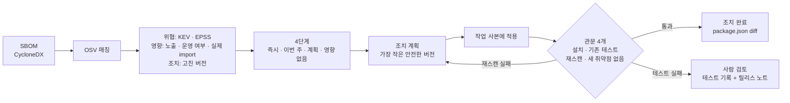

# FixGate

SBOM 취약점 경보를 **근거가 붙은 처리 순서**로 바꾸고, **검증 관문을 통과한 조치만** 완료로 치는 에이전트.

An agent that turns SBOM vulnerability alerts into a fix order with sourced reasons, and counts a fix as done only after the tests and a fresh scan pass.

## 왜 필요한가

- 2025년 한 해 공개된 CVE는 48,185건으로 전년보다 20.6% 늘었다 ([Jerry Gamblin](https://jerrygamblin.com/2026/01/01/2025-cve-data-review/)).
- 그중 실제 공격에 쓰인 기록이 있는 것은 공개 CVE의 약 6%다 ([Cyentia·FIRST](https://www.cyentia.com/epss/)).
- 스캐너는 심각도 순 목록을 준다. 무엇부터 고칠지, 고친 뒤 정말 해결됐는지는 사람이 한 건씩 확인한다.

## 흐름



## 예제 결과 — `examples/shop-api`

라이브러리 4개(express, axios, jsonwebtoken, lodash)를 오래된 버전으로 쓰는 예제 서비스다. 인터넷 노출, 개인정보 처리로 설정했다. 2026-10-28 실행 결과:

| | 조치 전 | 조치 후 |
|---|---|---|
| 경보 | 67건 (구성요소 149개 중 15개) | 22건 |
| 즉시 · 이번 주 | 20건 | 1건 |
| 영향 없음 (개발 전용) | 19건 | 19건 — VEX 제안으로 기록 |

- **axios** 0.21.1 → 0.34.0, **lodash** 4.17.20 → 4.18.1: 관문 4개 통과.
- **express** 4.17.1 → 4.20.0: 자기 취약점은 사라졌지만 '새 취약점 없음' 관문에서 막혔다 (qs가 새 권고에 걸림). 에이전트가 다음 후보 4.22.3을 시도해 통과.
- **jsonwebtoken** 8.5.1 → 9.0.0: 기존 테스트가 실패해 되돌리고 사람에게 넘김. 릴리스 노트에서 원인을 찾아 함께 넘긴다: "RSA key size must be 2048 bits or greater." 이 서비스는 1024비트 키를 쓴다. 키 교체는 사람이 정할 일이다.

## 원칙

1. **사실은 도구가 가져온다.** 버전, 권고, 악용 확률은 모두 공개 DB에서 오고, 보고서의 모든 근거에 출처가 붙는다.
2. **관문을 통과하기 전에는 완료가 아니다.** 설치, 기존 테스트, 재스캔, 새 취약점 없음. 테스트가 없는 서비스는 검증할 수 없으므로 조치를 완료로 치지 않는다. ([ai-agent-guardrails](https://github.com/JeongMoJin/ai-agent-guardrails)와 같은 규칙)
3. **원본은 건드리지 않는다.** 조치는 임시 작업 사본에서만 시도하고, 패키지 설치 스크립트는 실행하지 않는다(`--ignore-scripts`).
4. **결정은 사람이 한다.** '영향 없음'은 VEX 제안으로만 남기고, 변경 반영은 담당자가 승인한다.

## 사용법

Node.js 24 이상. TypeScript를 빌드 없이 바로 실행한다.

```bash
npm install
node src/cli.ts scan examples/shop-api      # 읽기만: 처리 순서 보고서
node src/cli.ts fix examples/shop-api       # 작업 사본에서 조치 + 관문 검증
node src/cli.ts scan <폴더> --sbom bom.json  # 다른 도구가 만든 CycloneDX SBOM 사용
```

결과는 `fixgate-out/<서비스>/`에 남는다: `report.html`, `report.md`, `vex.json`, `findings.json`, 조치 후 `package.json`·`package-lock.json`.

서비스 맥락은 서비스 폴더의 `fixgate.json`에 적는다. 없으면 인터넷 노출·중요도 medium으로 본다.

```json
{ "service": "shop-api", "exposure": "internet", "criticality": "high", "personalData": true, "owner": "커머스 개발팀" }
```

## 우선순위 규칙

CISA [SSVC](https://www.cisa.gov/stakeholder-specific-vulnerability-categorization-ssvc)의 순서(악용 → 노출 → 영향)를 따른다.

| 조건 | 단계 |
|---|---|
| 개발·테스트 전용 의존성 | 영향 없음 (VEX 제안) |
| CISA KEV 등재 | 즉시 |
| EPSS 10% 이상 또는 상위 5% | 인터넷 노출이면 즉시, 내부면 이번 주 |
| 심각도 HIGH · CRITICAL | 인터넷 노출이거나 중요 서비스면 이번 주, 아니면 계획 |
| 그 밖 | 계획 |

## 한계

- 조치(fix)는 지금 npm 프로젝트만 지원한다. 매칭과 우선순위(scan)는 CycloneDX SBOM이면 생태계와 관계없이 동작한다.
- '실제 사용'은 패키지 단위 import 검색이다. 취약한 함수까지 따라가는 도달성 분석은 아니다.
- 단계 임계값(EPSS 10%, 상위 5%)은 조직 정책에 맞게 조정해야 한다.
- 다음 단계: 관문이 실패했을 때 테스트 기록·릴리스 노트·코드 사용처를 묶어 원인과 선택지를 설명하는 LLM 단계. 사실 판단에는 쓰지 않는다.

## 데이터 출처

[OSV](https://osv.dev) · [FIRST EPSS](https://www.first.org/epss/) · [CISA KEV](https://www.cisa.gov/known-exploited-vulnerabilities-catalog) · npm registry. 응답은 `.fixgate-cache/`에 하루 동안 보관해 같은 사실로 다시 돌릴 수 있다.

## License

MIT
